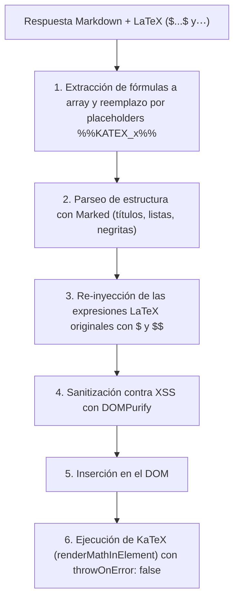
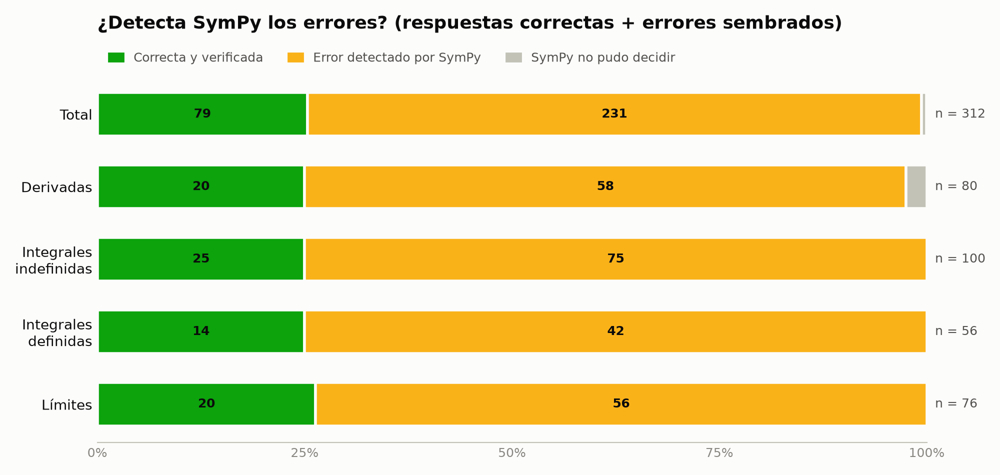

# 🎓 Tutor Inteligente de Cálculo Universitario

> **Aplicación Web Educativa para Cálculo Diferencial, Integral y Multivariado.**  
> Diseñada para brindar explicaciones pedagógicas paso a paso con justificación rigurosa, verificación de resultados, prevención de errores comunes y renderizado matemático de alta calidad con KaTeX.

---

## 📋 Tabla de Contenidos
1. [Descripción del Proyecto y Contexto Académico](#-descripción-del-proyecto-y-contexto-académico)
2. [Arquitectura y Estructura](#-arquitectura-y-estructura)
3. [Requisitos Previos](#-requisitos-previos)
4. [Instalación y Configuración Paso a Paso](#-instalación-y-configuración-paso-a-paso)
5. [Ejecución](#-ejecución)
6. [Diseño Pedagógico y System Prompt](#-diseño-pedagógico-y-system-prompt)
7. [Pipeline de Renderizado Matemático (LaTeX / KaTeX)](#-pipeline-de-renderizado-matemático-latex--katex)
8. [Verificación Simbólica con SymPy y Experimento](#-verificación-simbólica-con-sympy-y-experimento)
9. [Gestión de Historial y Consumo de Tokens](#-gestión-de-historial-y-consumo-de-tokens)
10. [Guía de Solución de Problemas (Troubleshooting)](#-guía-de-solución-de-problemas-troubleshooting)
11. [Trabajo Futuro](#-trabajo-futuro)

---

## 💡 Descripción del Proyecto y Contexto Académico

Este proyecto fue desarrollado en el marco de un curso universitario de desarrollo web e inteligencia artificial aplicada. El objetivo principal es ofrecer un **tutor inteligente que no se limite a dar respuestas finales**, sino que acompañe al estudiante en la comprensión conceptual de cada técnica matemática:

- **Cálculo Diferencial:** Límites, continuidad, derivadas por definición, reglas de derivación (cadena, producto, cociente), derivación implícita y optimización.
- **Cálculo Integral:** Integrales inmediatas, métodos de integración (sustitución, por partes, fracciones parciales, sustitución trigonométrica), integrales impropias y aplicaciones (áreas, volúmenes).
- **Cálculo Multivariado:** Funciones de varias variables, límites multivariables, derivadas parciales y direccionales, gradiente, planos tangentes, regla de la cadena multivariable y extremos con multiplicadores de Lagrange.

**Enfoque de diseño:** Código limpio, sin sobre-ingeniería (sin Docker ni frameworks frontend pesados), fácil de explicar y defender ante un jurado académico.

---

## 🏗 Arquitectura y Estructura

El proyecto sigue una arquitectura monolítica ligera: un único servidor en FastAPI que expone la API REST y sirve los archivos estáticos del frontend.

```text
proyecto/
├── app.py                 # Servidor FastAPI + endpoints + control de errores
├── prompts.py             # System prompt pedagógico y reglas de KaTeX
├── verificador.py         # Comprobación simbólica de los resultados con SymPy
├── graficador.py          # Puntos de las gráficas (curvas, áreas, tangentes, superficies) con SymPy
├── requirements.txt       # Dependencias fijadas con versiones exactas
├── .env.example           # Plantilla de variables de entorno
├── .gitignore             # Exclusión de credenciales y temporales
├── README.md              # Documentación completa del proyecto
├── tests/
│   ├── test_app.py        # Pruebas de integración con pytest y TestClient
│   ├── test_verificador.py # Verificación con SymPy y bloqueo de código malicioso
│   ├── test_graficador.py # Gráficas: tangentes exactas, asíntotas y datos inválidos
│   ├── test_experimento.py # Valida las 79 claves de respuesta del banco
│   └── test_latex_pipeline.py # Pruebas del pipeline de placeholders LaTeX
├── experimento/
│   ├── ejercicios.json    # Banco de 79 ejercicios con clave de respuesta
│   ├── evaluar.py         # Corre el experimento y genera resultados.md
│   └── grafica.py         # Gráficas para el póster (resultados*.png)
└── static/
    ├── index.html         # Interfaz de usuario con CDNs
    ├── styles.css         # Tema oscuro moderno con CSS variables (WCAG AA)
    └── app.js             # Pipeline de renderizado KaTeX y gestión multi-turno
```

---

## ⚙️ Requisitos Previos

- **Python:** Versión `3.10` o `3.11` (verificado en Python 3.11.9).
- **Navegador web moderno:** Chrome, Edge, Firefox, Safari u Opera con soporte de JavaScript moderno (ES6+).
- **Clave de API de Google Gemini:** Gratuita a través de [Google AI Studio](https://aistudio.google.com/).

---

## 🚀 Instalación y Configuración Paso a Paso

### 1. Clonar o abrir el directorio del proyecto
Abre tu terminal en la carpeta raíz del proyecto:
```bash
cd c:/proyecto_calculo
```

### 2. Crear y activar un entorno virtual
**En Windows (PowerShell):**
```powershell
python -m venv venv
.\venv\Scripts\Activate.ps1
```

**En Linux / macOS:**
```bash
python3 -m venv venv
source venv/bin/activate
```

### 3. Instalar las dependencias fijadas
```bash
pip install -r requirements.txt
```

### 4. Configurar la clave de API de Google Gemini
1. Ve a [https://aistudio.google.com/](https://aistudio.google.com/) e inicia sesión con tu cuenta de Google.
2. Haz clic en **"Get API key"** y crea una nueva clave de API.
3. En la raíz del proyecto, crea tu archivo `.env` a partir de la plantilla `.env.example`:
   ```bash
   cp .env.example .env
   ```
   *(En Windows PowerShell: `Copy-Item .env.example .env`)*
4. Abre `.env` y pega tu clave:
   ```env
   GEMINI_API_KEY=AIzaSy...TuClaveAqui
   GEMINI_MODEL=gemini-3.8-flash
   PORT=8000
   ```

> [!NOTE]
> El archivo `.env` está expresamente excluido en `.gitignore` para proteger tus credenciales.

---

## ▶️ Ejecución

Para iniciar la aplicación, ejecuta el siguiente comando:

```bash
python app.py
```

O si prefieres el CLI de Uvicorn con auto-recarga:
```bash
uvicorn app:app --host 0.0.0.0 --port 8000 --reload
```

Abre tu navegador en:
👉 **[http://localhost:8000](http://localhost:8000)**

Para ejecutar las pruebas automatizadas:
```bash
python -m pytest -v
```

---

## 🧠 Diseño Pedagógico y System Prompt

El corazón metodológico del tutor reside en [prompts.py](file:///c:/proyecto_calculo/prompts.py). Cada vez que el estudiante formula un problema o ejercicio, el tutor aplica la siguiente estructura estandarizada de 5 fases:

1. **Identificación:** Clasificación precisa del problema y técnica aplicable.
2. **Concepto Clave:** Teorema, definición o fórmula fundamental explicada con intuición matemática.
3. **Desarrollo Paso a Paso:** Procedimiento algebraico secuencial y riguroso, justificando explícitamente cada cambio de variable, regla o propiedad aplicada.
4. **Verificación:** Guía práctica para que el estudiante auto-compruebe su resultado (ej. derivando la antiderivada, analizando límites o simetrías).
5. **Error Común:** Advertencia sobre las trampas típicas cometidas por estudiantes universitarios en ese tema en particular.

Si el estudiante realiza preguntas conceptuales puras o preguntas de seguimiento multi-turno (*"¿por qué multiplicaste por $2x$ en el paso 2?"*), el modelo responde de forma adaptativa manteniendo el hilo pedagógico sin reiniciar la estructura completa.

---

## 🧮 Pipeline de Renderizado Matemático (LaTeX / KaTeX)

Uno de los mayores desafíos en aplicaciones de IA y matemáticas es que los parsers de Markdown destruyen la notación LaTeX (los subíndices `_` se convierten en cursiva, los `*` en negrita, y las barras `\` se escapan).

Para solucionar esto de manera determinista, implementamos una estrategia de **Extracción por Placeholders** en [static/app.js](file:///c:/proyecto_calculo/static/app.js):



### Casos de prueba verificados:
- ✅ **Integral definida con límites:** `$\int_{0}^{\pi} \sin(x)\,dx = 2$`
- ✅ **Fracción con derivadas parciales:** `$$\frac{\partial^2 f}{\partial x \partial y}$$`
- ✅ **Límite:** `$\lim_{x \to 0} \frac{\sin x}{x} = 1$`
- ✅ **Display alineado multilínea:** `$$\begin{aligned} ... \end{aligned}$$`
- ✅ **Texto en negrita contiguo a fórmula:** `**Paso 1:** Calculamos $\frac{df}{dx}$`
- ✅ **Listas ordenadas de Markdown** con fórmulas en cada elemento.

---

## ✅ Verificación Simbólica con SymPy y Experimento

**Problema:** los modelos de lenguaje a veces cometen errores algebraicos con total seguridad.
**Solución: la IA propone, SymPy comprueba.** Al final de cada ejercicio, Gemini adjunta un bloque oculto con su resultado en sintaxis SymPy. El backend ([verificador.py](verificador.py)) lo comprueba de forma independiente:

| Tipo | Cómo se comprueba |
| :--- | :--- |
| Derivada (y parcial) | SymPy deriva la función y compara con la respuesta |
| Integral indefinida | Se deriva la respuesta y debe recuperarse el integrando |
| Integral definida | Integración numérica (y exacta si la numérica no coincide) |
| Límite | SymPy calcula el límite y compara |

El estudiante ve un sello: **✅ verificado**, **⚠️ SymPy obtuvo otro resultado** (con el valor correcto) o **❔ no se pudo decidir**.
Como `parse_expr` usa `eval`, solo se aceptan caracteres, funciones y variables de una lista permitida, sin acceso a `__builtins__`.

### Experimento ([experimento/resultados.md](experimento/resultados.md))

**Parte 1: Gemini resolviendo ejercicios reales** (`gemini-2.5-flash`, 21 ejercicios: 20 derivadas y 1 integral). Gemini acertó 21/21 y SymPy verificó las 21. La muestra es pequeña porque la cuota gratuita de la API permite 20 peticiones por día.

**Parte 2: errores sembrados (prueba del detector, sin API).** A las 79 claves de respuesta correctas se les aplicaron errores deliberados (signo cambiado, factor 2, término de más):

| Métrica | Resultado |
| :--- | :---: |
| Errores detectados con ⚠️ | **99.1%** (231/233) |
| Errores aprobados con ✅ por equivocación | **0** (0/233) |
| Falsas alarmas en respuestas correctas | **0%** (0/79) |
| Sin decidir ❔ | 0.6% (2/312, ambos en $\sin(x)^{\cos(x)}$) |



**Limitaciones (para defender ante el jurado):**
- Los errores sembrados son algebraicos y simples; los errores reales de un modelo pueden ser más sutiles (aunque SymPy compara el valor matemático, no la forma, así que cualquier resultado distinto se detecta).
- Si la IA transcribe mal el enunciado en el bloque, SymPy verifica el problema equivocado. El experimento mide esto aparte: compara contra el enunciado original del banco.
- No cubre gradientes, planos tangentes ni multiplicadores de Lagrange.

Reproducir:
```bash
python -X utf8 experimento/evaluar.py --sembrados   # parte 2 (sin API, ~25 s)
python -X utf8 experimento/evaluar.py               # parte 1 (usa la API; retoma donde quedó)
python -X utf8 experimento/grafica.py --sembrados
```

---

## 📈 Gráficas Interactivas en la Pizarra

Cuando una gráfica ayuda a entender, Gemini agrega un bloque oculto ```grafica``` que describe qué dibujar. El backend ([graficador.py](graficador.py)) calcula los puntos con SymPy, usando el mismo parser seguro del verificador, y la pizarra los dibuja con Plotly:

- **2D:** hasta 4 funciones, área sombreada bajo la curva (integrales definidas) y recta tangente con su punto. La pendiente es la derivada exacta de SymPy, no un valor que propone la IA.
- **3D:** superficies $z = f(x, y)$ con plano tangente $z = f(a,b) + f_x(a,b)(x-a) + f_y(a,b)(y-b)$, rotables con el mouse.
- Las asíntotas (por ejemplo $	an x$ o $1/x$) se cortan para no dibujar líneas verticales falsas, y el eje y se limita si unos pocos valores enormes aplastan la gráfica.

---

## 🔄 Gestión de Historial y Consumo de Tokens

Para permitir un diálogo multi-turno continuo mientras se protege la cuota de la API:
1. El frontend almacena el historial en memoria durante la sesión activa.
2. Al enviar `POST /api/chat`, el backend toma una ventana deslizante de los últimos $N=10$ mensajes (`MAX_HISTORIAL_MENSAJES = 10`), garantizando hasta 5 intercambios completos de contexto sin exceder los límites de tokens ni degradar la velocidad de respuesta.

---

## 🛠 Guía de Solución de Problemas (Troubleshooting)

| Síntoma / Error | Causa Probable | Solución |
| :--- | :--- | :--- |
| **"No se encontró la variable GEMINI_API_KEY"** | Falta el archivo `.env` o la variable está vacía. | Crea el archivo `.env` copiando `.env.example` y asigna tu clave de Google AI Studio. |
| **"Error 401: API Key Inválida"** | Clave de API mal copiada o revocada. | Genera una nueva clave en [Google AI Studio](https://aistudio.google.com/) y actualiza `.env`. |
| **"Error 429: Cuota Excedida"** | Límite de peticiones por minuto alcanzado. | Espera 60 segundos antes de enviar tu siguiente consulta. En modo gratuito, Gemini ofrece suficiente cuota para pruebas académicas. |
| **"Error 504: Tiempo de espera agotado"** | Problema muy extenso o latencia de red. | Formula la pregunta de manera más acotada o divide el ejercicio en subpreguntas. |
| **"Puerto 8000 en uso"** | Otro servicio está usando el puerto 8000. | Cambia `PORT=8080` en tu archivo `.env` o ejecuta `uvicorn app:app --port 8080`. |
| **"Desconectado / Sin internet"** | Falla de conexión en el dispositivo. | El frontend detecta la pérdida de red y muestra un aviso amigable sin romper la aplicación. |

---

## 🔮 Trabajo Futuro (Roadmap)

Características planificadas para versiones posteriores:
- [ ] **Streaming SSE (Server-Sent Events):** Para renderizar las explicaciones token a token a medida que se generan.
- [ ] **Entrada Multimodal por Imagen:** Permitir a los estudiantes subir una fotografía del problema del cuaderno o libro de texto.
- [x] **Gráficas interactivas en la pizarra:** curvas, áreas bajo la curva, rectas tangentes, superficies 3D y planos tangentes (SymPy calcula los puntos y las derivadas exactas; Plotly los dibuja).
- [ ] **Campos vectoriales y gradientes** en las gráficas 3D.
- [ ] **Persistencia en Base de Datos:** Guardar sesiones y dudas favoritas usando SQLite o PostgreSQL.
- [ ] **Exportación a PDF / LaTeX:** Permitir descargar la sesión completa en un documento formateado para estudio.
